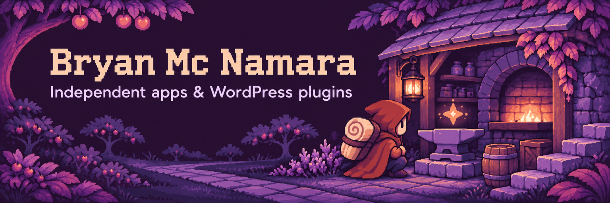

  

# Hi, I'm Bryan

I’m curious about how things work and enjoy turning everyday frustrations into useful software. Most of these projects started with something I wanted to use myself.

## iOS apps

- [Check-In: Physique](https://apps.apple.com/ie/app/check-in-physique/id6761781961) — guided progress photos and pose-by-pose comparisons.
- [Check-In: Scales](https://apps.apple.com/ie/app/check-in-scales/id6790448672) — weight tracking, trends, and goals.
- [Check-In: Macros](https://apps.apple.com/ie/app/check-in-macros/id6806688584) — calorie and macro tracking.
- [Rouse](https://apps.apple.com/ie/app/rouse-custom-sound-alarm/id6814202740) — an alarm app that lets you use your own audio.
- [Rift Counter](https://apps.apple.com/ie/app/rift-counter/id6812848378) — an offline scorekeeper for two people playing Riftbound.
- [LessFile](https://apps.apple.com/ie/app/lessfile/id6829953037) — compress photos, videos, and files on iPhone and iPad.
- **Tonalith** — a photo editor in development.

See the [Check-In website](https://check-in.fit) for the fitness apps.

## WordPress plugins

- [Lanternmote Change Log](https://github.com/seraphalaric-beep/change-vigil-site-journal) — review and export a searchable history of changes on a WordPress site. The public preview is gathering feedback.
- **Waynotch Redirect Manager** — manage redirects, check missing pages, and review imports. The repository is private, so there is no public link yet.
- **Sealwick Mail Check** — run a simple WordPress mail test. This is an early private prototype and is not ready for public use.

## Android apps

The Android editions of Check-In: Physique, Scales, and Macros are in development. Their repositories are private for now; public links will follow when builds are ready.

## Web apps

- [Sheet of Holding](https://character-sheet-web.vercel.app) — an online character sheet for D&D 5e.
- **Tabletop Companion** — a broader character, campaign, and tabletop workspace in development.

## Other tools

- [JSON Minifier](https://github.com/seraphalaric-beep/json-minifier) — a small desktop tool for validating and minifying JSON.
